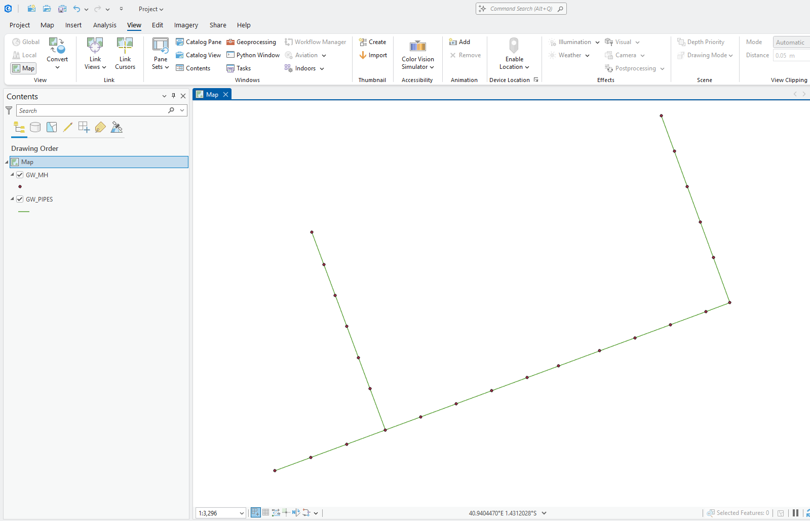
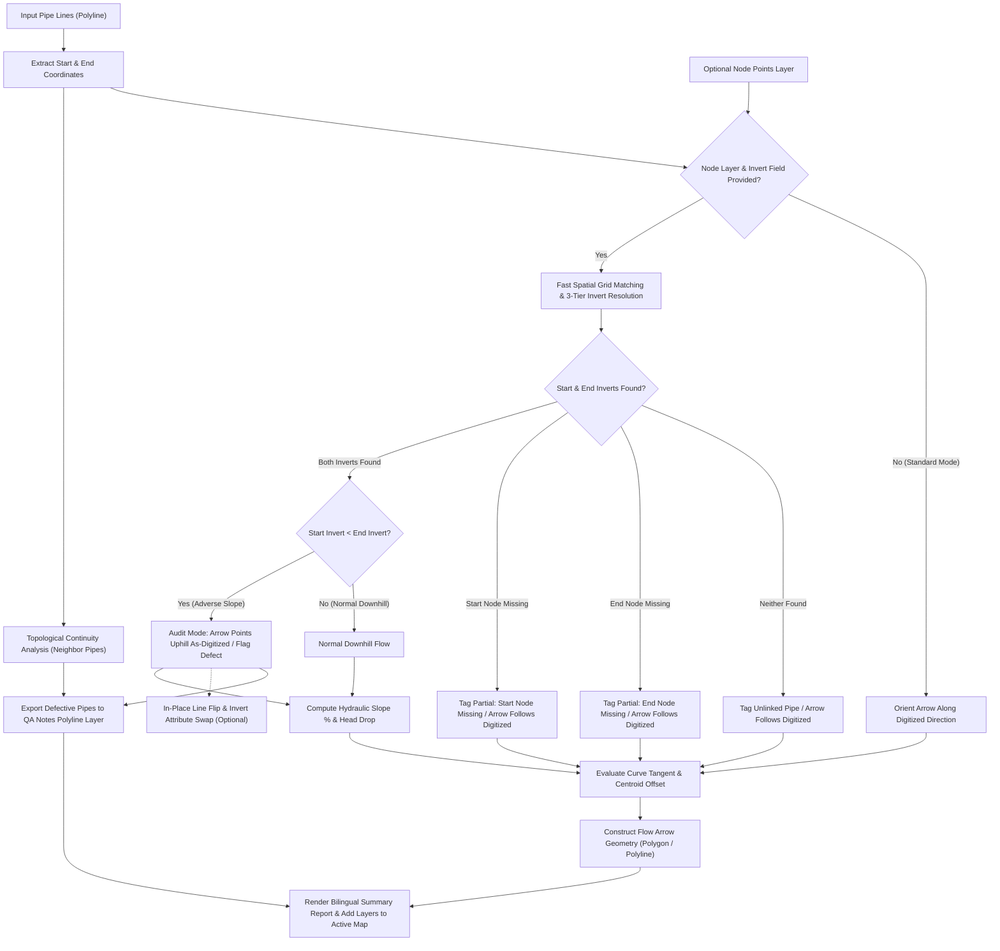

<div align="center">

# 🌊 CreateFlowArrow Tool
### High-Performance Flow Direction Arrows & Comprehensive QA/QC Gravity Networks Engine for ArcGIS
### أداة إنشاء أسهم اتجاه السريان وتدقيق شبكات الانحدار والجاذبية في ArcGIS

[](https://www.esri.com/en-us/arcgis/products/arcgis-pro/overview)
[](https://desktop.arcgis.com/en/arcmap/)
[](https://www.python.org/)
[](LICENSE)

[ 🇬🇧 English Documentation ](#-english-documentation) • [ 🇸🇦 الشرح باللغة العربية ](#-الشرح-باللغة-العربية)

</div>

---

# 🇬🇧 English Documentation

## 📖 Overview & Engineering Concept

In civil engineering and municipal infrastructure GIS projects, gravity-driven conveyance networks:
- 🌧️ **Stormwater Drainage & Flood Control Networks**
- 💧 **Groundwater Lowering / Dewatering Networks**
- 🚽 **Sanitary Sewer & Wastewater Networks**

Fluid conveyance relies strictly on topographical gravity gradient—moving naturally from higher hydraulic grade to lower hydraulic grade ($Z_{upstream} > Z_{downstream}$). To ensure the validity of GIS topology, hydraulic modeling (e.g. SWMM, SewerGEMS, InfoWorks ICM), and spatial asset management:
**Pipe polyline features must be digitized strictly in the true direction of physical flow (from Upstream Manhole to Downstream Manhole).**

### The Industry Challenge:
Networks imported from AutoCAD civil drawings, legacy GIS databases, or surveyed field CAD lines frequently suffer from:
1. **No visual flow arrow symbology**, making manual flow direction verification exhausting across thousands of pipes.
2. **Reversed digitizing direction errors** (pipes drawn uphill, from downstream to upstream), which breaks hydraulic network traces, disconnects watershed routing, and corrupts network calculations.
3. **Pipes without start nodes / terminal links** (cul-de-sacs, building service connections, catch basins, or outfalls) that do not start at an indexed manhole point.
4. **Topological Collisions** where multiple pipes converge head-to-head into a manhole without downstream outlet.
5. **Encoding & Language Conflicts** when working with Arabic/non-Latin folder paths, geodatabase names, or localized attribute schemas.

### The Solution:
**CreateFlowArrow** is an advanced, high-performance standalone ArcGIS Python Toolbox (`.pyt`) that:
1. Generates geometric flow direction arrows (**Polygon** triangles or **Polyline** open V-arrows) aligned precisely at each pipe's mathematical **midpoint** (or custom placement ratio: 25%, 50%, 75%).
2. Aligns arrow center-of-gravity (centroid) with the pipe line to eliminate visual distortion.
3. Calculates instantaneous **tangents along curves** to guarantee smooth flow orientation even on curved conduit alignments.
4. **Smart Node Invert & Slope Percentage Engine:**
   - Activated strictly when the user provides the **Optional Node Points Layer** and selects the **Node Invert Elevation Field**.
   - Uses high-speed spatial grid hashing ($O(1)$) to snap pipe endpoints to node points.
   - **3-Tier Invert Resolution:** Exact snapping tolerance $\rightarrow$ Adaptive soft tolerance ($1.5\times$) $\rightarrow$ Pipe feature attribute fallback.
   - **Robust Missing Node Handling:** Seamlessly processes pipes that do not start with a manhole node without errors ("تعمل تمام"), generating flow arrows along the digitized line and accurately documenting invert status.
   - Computes **Start Invert**, **End Invert**, **Invert Drop / Head**, **Pipe Length**, **Hydraulic Slope Percentage (`SLOPE_PCT %`)**, and **Slope Per-Mil (`SLOPE_PER_MIL ‰`)**.
5. **QA/QC Audit Mode (True-to-Life Error Visualization):**
   - In Audit Mode (`Auto-Flip = False`), arrows on adverse/reversed pipes are oriented **strictly in the line's digitized direction (uphill)** so the engineer visually sees the defect directly on the map.
   - When `Auto-Flip = True`, the tool flips the source line geometry in-place and orients the arrow downhill.
6. **Network Topological Continuity Analysis:**
   - Inspects pipes relative to their connected neighbors to detect **Head-to-Head Collisions**, **Tail-to-Tail Divergences**, and isolated reversals in continuous line runs.
7. **Dedicated QA Notes & Flagged Pipes Layer (`Flow_Direction_Arrows_QA_Notes`):**
   - Automatically generates a companion polyline layer containing defect-flagged pipes with engineering issue categories and recommended remedial actions.
8. **Full Arabic & International Path Support:**
   - Universal Unicode handling across Windows file paths, Arabic folder names (e.g. `D:\pythone\اداه تحديد الاتجاه\`), Arabic Geodatabases (`.gdb`), and Arabic attribute fields/aliases.
9. **Progress Bar & Performance Scaling:** Built-in `arcpy.SetProgressor` visual feedback and formatted bilingual execution summary report.

---

## 📸 Visual Demonstration (Before & After)

| Before Tool Execution (Raw lines with unknown flow directions) | After Tool Execution (Flow arrows aligned with downhill gravity flow) |
| :---: | :---: |
|  |  |

---

## 🚀 Key Features

- 🔄 **Dual-Platform Native Compatibility:**
  Seamlessly runs in both **ArcMap 10.1+ (Python 2.7)** and **ArcGIS Pro 2.x / 3.x (Python 3.x)** with automatic environment detection (`arcpy.mp` vs `arcpy.mapping`).
- 🌐 **Full Arabic Language & Unicode Compatibility:**
  Native support for Arabic folder names, file paths, geodatabases (`.gdb`), layer names, and attribute fields without encoding exceptions or console codepage crashes.
- 🎯 **Engineering Audit Mode (True-to-Life Error Display):**
  Reversed pipes show arrows pointing uphill as digitized so defects are visually apparent on the map.
- 🔍 **Topological Continuity & Neighbor Network Check:**
  Analyzes pipe connectivity to detect head-to-head collisions and flow interruptions at common manholes.
- 📋 **Dedicated QA/QC Notes Layer (`{output}_QA_Notes`):**
  Generates an overlay polyline layer containing flagged defective pipes with recommended corrective actions.
- 🔗 **Smart Missing Node & Partial Inverts Handling:**
  Pipes that do not start with a manhole point (e.g. terminal dead ends, house connections, outfalls) are handled gracefully without failure ("تعمل تمام"). Flow arrows are generated along the digitized path and tagged with `PARTIAL_START_MISSING`.
- 📦 **Self-Contained Python Toolbox (`.pyt`):**
  Zero complex dependencies or broken script paths. Double-click and execute directly.
- 📐 **Centroid Midpoint Alignment:**
  Calculates the exact triangle centroid $(X_c, Y_c)$ and applies an analytical offset so the arrow's center of gravity coincides flawlessly with the line placement point.
- 🔀 **Flexible Geometry Outputs (Polygon vs. Polyline):**
  Generate closed triangular arrowheads (`Polygon`) or open cartographic V-arrows (`Polyline`).
- 🎯 **Slope Percentage & Invert Analysis (On Node Points Input):**
  When a node points layer and invert field are specified, the tool computes hydraulic slope percentage (`SLOPE_PCT`), slope per mil (`SLOPE_PER_MIL`), and head drop.
- 🔄 **In-Place Auto-Flip & Attribute Swapping:**
  Optionally reverses the vertex order of uphill pipe polylines in-place and swaps `START_INV` / `END_INV` so your source network geometry becomes 100% hydraulically correct.
- 🔄 **Local Curve Tangent Calculation:**
  Evaluates the instantaneous slope between 49% and 51% along the curve, avoiding crude endpoint straight-line simplifications.
- 📋 **Full Attribute Preservation:**
  Inherits all original pipe attributes (diameter, material, length, slope) with an `ORIG_FID` key.
- ⚡ **O(1) Spatial Hashing & Progressor:**
  Sub-second spatial queries even across 100,000+ points and real-time step progress reporting.
- 🗺️ **Automatic Add to Active Map:**
  Dynamically loads the generated arrow layer and QA notes layer into the active Table of Contents (TOC) / Contents pane.
- 🧪 **Bundled Sample Training Data (`data/`):**
  Includes a sample File Geodatabase (`data/TEST.gdb`) and Shapefiles (`data/sample_gravity_pipes.shp`, `data/sample_manhole_nodes.shp`) for immediate testing.

---

## 🛠️ Engineering Workflow Architecture



---

## 💻 Installation & Usage Guide

### 1. ArcGIS Pro:
1. Clone or download the repository:
   ```bash
   git clone https://github.com/ahmadibrahim4geo/Create-FlowArrow-Tool.git
   ```
2. Open your project in **ArcGIS Pro**.
3. In the **Catalog** pane, right-click **Toolboxes** and select **Add Toolbox**.
4. Browse to the folder and pick `CreateFlowArrow.pyt`.
5. Open **Create Flow Direction Arrows**.
6. Set your inputs and click **Run**.

### 2. ArcMap:
1. Open your map document in **ArcMap**.
2. In the **Catalog** window, navigate to Folder Connections and open `CreateFlowArrow.pyt`.
3. Fill in the parameters and click **OK**.
4. The flow arrows will appear immediately in your Data Frame.

---

## ⚙️ Tool Parameters Reference

| # | Parameter Name | Data Type | Requirement | Default | Description |
|---|---|---|---|---|---|
| **0** | **Input Pipe Lines** | Feature Layer (Polyline) | Required | — | Target gravity-driven pipeline network layer. |
| **1** | **Output Geodatabase or Workspace** | Workspace / GDB | Required | — | Target File Geodatabase (.gdb) to store output feature class. |
| **2** | **Output Layer Name** | String | Required | `Flow_Direction_Arrows` | Feature class name of generated flow direction arrows. |
| **3** | **Output Geometry Type** | String (Choice) | Required | `Polygon` | Geometry type: `Polygon` (closed triangle) or `Polyline` (open V-arrow). |
| **4** | **Arrow Base Width (Meters)** | Double | Required | `2.0` | Transverse base width of the arrow in map units (meters). |
| **5** | **Arrow Height / Length (Meters)** | Double | Required | `5.0` | Axial height / length from base to tip in map units (meters). |
| **6** | **Transfer Pipe Attributes** | Boolean | Optional | `True` | Transfers original pipe attributes to arrow layer with `ORIG_FID`. |
| **7** | **Optional Node/Manhole Points Layer** | Feature Layer (Point) | Optional | `None` | Manhole/node points layer to evaluate invert elevations and slopes. |
| **8** | **Node Invert Elevation Field** | Field (Numeric) | Optional | `None` | Invert elevation field from node layer (e.g. `MANHOLEINVERTELEVATION`). |
| **9** | **Auto-Flip Reversed Pipe Lines** | Boolean | Optional | `False` | Reverses polyline digitizing direction in-place for adverse pipes. |
| **10** | **Node Snapping Tolerance (Meters)** | Double | Optional | `1.5` | Search tolerance to snap pipe ends to manholes. |
| **11** | **Arrow Placement Along Pipe** | String (Choice) | Optional | `Midpoint (50%)` | Relative placement: `Midpoint (50%)`, `Quarter (25%)`, or `Three-Quarters (75%)`. |
| **12** | **Swap Invert Attributes on Flip** | Boolean | Optional | `True` | Swaps start and end invert attributes on flipped pipes. |
| **13** | **Generate QA/QC Audit Notes Layer** | Boolean | Optional | `True` | Generates a dedicated polyline layer containing defect-flagged pipes. |
| **14** | **Output Flow Arrows Layer** | Feature Class | Derived (Output) | — | Derived output for ModelBuilder and automated script chains. |
| **15** | **Output QA Notes Layer** | Feature Class | Derived (Output) | — | Derived QA notes polyline output for flagged pipes. |

---

## 📊 Output Attribute Schema & QA/QC Fields

### Main Flow Arrows Layer:
| Field Name | Type | Description |
|---|---|---|
| `ORIG_FID` | LONG | Original pipe feature ObjectID / FID. |
| `QA_FLOW_STATUS` | TEXT (255) | Detailed human-readable hydraulic flow & slope description (bilingual). |
| `QA_SEVERITY` | TEXT (30) | Standard status code: `NORMAL_DOWNHILL`, `ADVERSE_SLOPE`, `ZERO_SLOPE`, `PARTIAL_START_MISSING`, `PARTIAL_END_MISSING`, `UNLINKED_NODES`, `DIGITIZED_ONLY`. |
| `TOPOLOGY` | TEXT (50) | Network continuity code: `CONTINUOUS_FLOW`, `HEAD_TO_HEAD_COLLISION`, `TAIL_TO_TAIL_DIVERGENCE`, `UPSTREAM_ORIGIN`, `DOWNSTREAM_OUTFALL`, `ISOLATED_PIPE`. |
| `START_INV` | DOUBLE | Upstream / Start Invert Elevation (m) - *Calculated when Node Points are provided*. |
| `END_INV` | DOUBLE | Downstream / End Invert Elevation (m) - *Calculated when Node Points are provided*. |
| `INVERT_DROP` | DOUBLE | Invert drop / head: $Z_{start} - Z_{end}$ (m) - *Calculated when Node Points are provided*. |
| `PIPE_LEN` | DOUBLE | Pipe geometric length (m). |
| `SLOPE_PCT` | DOUBLE | Hydraulic slope percentage: $\frac{Drop}{Length} \times 100$ (%) - *Calculated when Node Points are provided*. |
| `SLOPE_PER_MIL` | DOUBLE | Hydraulic slope per mil: $\frac{Drop}{Length} \times 1000$ (‰) - *Calculated when Node Points are provided*. |
| `FLIPPED` | TEXT (10) | `YES` if pipe geometry was auto-flipped in-place, else `NO`. |

### QA/QC Audit Notes Layer (`{output}_QA_Notes`):
| Field Name | Type | Description |
|---|---|---|
| `ORIG_FID` | LONG | Original pipe feature ObjectID / FID. |
| `DEFECT_TYPE` | TEXT (50) | Defect category: `ADVERSE_SLOPE`, `MISSING_START_NODE`, `MISSING_END_NODE`, `UNLINKED_NODES`, `TOPOLOGY_CONFLICT`, `ZERO_SLOPE`. |
| `SEVERITY` | TEXT (25) | Severity level: `CRITICAL_ERROR`, `WARNING`, `ADVISORY`. |
| `DEFECT_DESC` | TEXT (255) | Detailed engineering defect diagnosis (bilingual). |
| `RECOMMENDED_ACTION` | TEXT (255) | Specific corrective engineering action to fix the defect. |
| `START_INV` / `END_INV` | DOUBLE | Upstream & downstream invert elevations. |
| `DROP_M` / `SLOPE_PCT` | DOUBLE | Hydraulic drop (m) and slope percentage (%). |
| `TOPOLOGY` | TEXT (50) | Topological continuity classification. |

---

## 💡 Understanding the QA/QC Alert (Yellow Warning ⚠️)

When running the tool, ArcGIS may display a yellow warning banner at completion:
```text
QA/QC Alert: Identified X pipe(s) with adverse/reversed slope. Arrows oriented as digitized to reveal errors. Enable 'Auto-Flip' to correct in-place.
```
> [!NOTE]
> **This is NOT a tool failure!**
> The tool completed 100% successfully. In ArcGIS, any tool that issues an engineering advisory (`arcpy.AddWarning`) displays a yellow status icon.
> In **Audit Mode**, the arrows on reversed pipes are shown pointing uphill (as digitized) so the defect is visually apparent to the engineer. The tool also creates a dedicated QA Notes layer highlighting these pipes. If you want the tool to automatically reverse the digitized direction of the source line layer itself, check the **Auto-Flip Reversed Pipe Lines** checkbox and re-run.

---

## 🧪 Sample Training Dataset (`data/`)

The repository includes a ready-to-use dataset in the `data/` directory:
- **`TEST.gdb`**: File Geodatabase containing:
  - `GW_PIPES`: Groundwater drainage pipes with hydraulic properties.
  - `GW_MH`: Manhole points with the `INVERT_M` elevation field.
- **`sample_gravity_pipes.shp`**: Sample shapefile containing 4 normal pipes and 2 intentionally reversed pipes (`P-103` & `P-105`).
- **`sample_manhole_nodes.shp`**: Manholes snapped to pipe ends with invert elevations.
- See `data/README.md` for a quick step-by-step walkthrough.

---

# 🇸🇦 الشرح باللغة العربية

## 📖 فكرة المشروع والمشكلة الهندسية (Project Concept)

في مشاريع البنية التحتية وشبكات الانحدار والجاذبية (**Gravity Flow Networks**):
- 🌧️ **شبكات تصريف مياه الأمطار والسيول (Stormwater Drainage)**
- 💧 **شبكات تخفيض منسوب المياه الجوفية (Groundwater Lowering / Dewatering)**
- 🚽 **شبكات الصرف الصحي (Sanitary Sewer Networks)**

تعتمد حركة السوائل على الانحدار الطبيعي من المنسوب المرتفع إلى المنسوب المنخفض ($Z_{upstream} > Z_{downstream}$). ولضمان سلامة النماذج الهيدروليكية وقواعد البيانات الجغرافية، **يجب رسم المواسير هندسياً باتجاه السريان**: من المطبق العلوي (**Upstream Node**) إلى المطبق السفلي (**Downstream Node**).

### التحدي الشائع في المشاريع:
الكثير من البيانات الموردة من الرفع المساحي أو المخططات المستوردة من أوتوكاد (CAD Drawings):
1. **تفتقر تماماً لطبقة تعبر عن اتجاه السريان بوضوح.**
2. **تحتوي على مواسير رُسمت بالخطأ باتجاه عكسي** (من أسفل إلى أعلى)، مما يؤدي لخلل في التحليلات الهيدروليكية وحسابات الشبكة.
3. **وجود مواسير لم تبدأ بنقطة منهل** (مثل نهايات الخطوط الميتة Cul-de-sacs، التوصيلات المنزلية، أو المصارف المكشوفة).
4. **حدوث تصادمات سريان عند المطابق (Head-to-Head Collisions)** حيث تلتقي ماسورتان في نفس المنهل دون وجود مخرج.
5. **مشاكل المسارات وقواعد البيانات باللغة العربية** التي تسبب أخطاء ترميز (Encoding) في أدوات بايثون التقليدية.

### الحل المطور في الإصدار المحدث (v2.6):
تقوم أداة **CreateFlowArrow** ببناء محرك متكامل لتدقيق الجودة الهندسية وإنشاء طبقة أسهم اتجاه السريان:
1. **وضع التدقيق الصادق (Audit Mode):**
   - السهم يُرسم في وضع التدقيق الافتراضي **باتجاه رسم الماسورة الفعلي كما هو (بالمقلوب)** ليرى المهندس الخطأ بعينه على الخريطة دون تجميل أو إخفاء!
   - وعند رغبة المستخدم في التصحيح التلقائي، يُفعل خيار `Auto-Flip` لتقوم الأداة بعكس رسم الخط في مكانه وتوجيه السهم مع الجاذبية.
2. **فحص الاستمرارية الطوبولوجية للمواسير المحيطة (Network Continuity Check):**
   - تفحص الأداة اتصال كل ماسورة بالمواسير المجاورة لها عند المطابق المشتركة لرصد:
     * **تصادم الرؤوس (Head-to-Head Collision):** ماسورتان أو أكثر تصبان في نفس المنهل دون مخرج downstream.
     * **تفرع الأذيال (Tail-to-Tail Divergence):** ماسورتان تبدآن من نفس المنهل دون خط تغذية upstream.
     * **الماسورة الشاذة وسط المسار (Isolated Reversal).**
3. **طبقة مخرجات مخصصة للملاحظات والأخطاء (`Flow_Direction_Arrows_QA_Notes`):**
   - تُنشئ الأداة تلقائياً طبقة خطية مستقلة تحتوي حصرياً على المواسير التي بها ملاحظات أو عيوب هندسية، مع تسجيل نوع الخلل (`DEFECT_TYPE`)، درجة خطورته (`SEVERITY`)، وشرح الخلل، والإجراء التصحيحي المقترح (`RECOMMENDED_ACTION`)، وتُضاف للخريطة بلون مميز لسهولة الفحص والمعالجة.
4. **دعم كامل للغة العربية والمسارات:**
   - تعمل الأداة بسلاسة تامة مع المسارات العربية وقواعد البيانات والطبقات والحقول دون أي انهيار في الترميز.
5. **معالجة المواسير التي لم تبدأ بنقطة منهل بسلاسة تامة ("تعمل تمام"):**
   - نظام التقاط ثلاثي المستويات: دقيق $\rightarrow$ موسع $\rightarrow$ بديل سمات الماسورة.
   - في حال عدم وجود نقطة منهل، يُنشأ السهم بنجاح وفقاً لاتجاه الرسم وتُوثق الحالة بـ `PARTIAL_START_MISSING`.
6. **محاذاة مركز ثقل السهم** هندسياً ومماس المنحنيات اللحظي لمنع أي تشوه بصري.
7. **تقرير ختامي ملخص ثنائي اللغة** يوضح الإحصائيات الهيدروليكية ونسبة الإنجاز بدقة.

---

## 🚀 المميزات الرئيسية (Key Features)

- 🔄 **توافق مزدوج كامل (Dual-Platform Compatibility):**
  تعمل بسلاسة مطلقة على **ArcMap (Python 2.7)** و **ArcGIS Pro (Python 3.x)**.
- 🌐 **دعم كامل للغة العربية (Arabic Unicode Support):**
  معالجة ذكية للمسارات العربية وقواعد البيانات والطبقات والحقول العربية.
- 🎯 **وضع التدقيق الهندسي (Audit Mode):**
  رؤية الأخطاء والمواسير المعكوسة بالعين المجردة على الخريطة كما رُسمت.
- 🔍 **فحص استمرارية الشبكة (Network Continuity):**
  رصد تصادم السريان وتفرعه عند المطابق المشتركة.
- 📋 **طبقة ملاحظات مستقلة للأخطاء (QA Notes Layer):**
  تصدير طبقة خطية تسرد العيوب المكتشفة والإجراءات التصحيحية المقترحة.
- 🔗 **معالجة متقدمة للمواسير غير المتصلة أو أحادية النقاط:**
  ضمان استمرار عمل الأداة بنجاح 100% وتوليد الأسهم حتى للمواسير التي تفتقر لمطابق عند البداية أو النهاية.
- 📦 **صندوق أدوات برمجي متكامل (Self-Contained Python Toolbox - `.pyt`):**
  أداة مدمجة وموحدة دون الحاجة لربط ملفات خارجية أو إعداد مسارات يدوية.
- 🔄 **التصحيح التلقائي المزدوج (Auto-Flip & Invert Swap):**
  تصحيح هندسة الخطوط المعكوسة وتبديل قيم المناسيب لمنع أي تضارب بين الرسم والبيانات.
- ⚡ **أداء فائق الفاعلية وفهرسة شبكية O(1):**
  معالجة عشرات الآلاف من المواسير والمطابق في ثوانٍ معدودة مع شريط تقدم `SetProgressor`.
- 🗺️ **الإضافة الفورية للخريطة (Auto-Add to Map):**
  تضاف الطبقات الناتجة تلقائياً إلى الخريطة النشطة وجدول المحتويات.
- 🧪 **حزمة بيانات تدريبية مدمجة (`data/`):**
  قاعدة بيانات جغرافية `TEST.gdb` وملفات shapefile جاهزة فوراً للتجربة والاختبار.

---

## ⚙️ بارامترات الأداة (Parameters Reference)

| # | المعامل (Parameter) | النوع (Type) | الحالة | الوصف |
|---|---|---|---|---|
| **0** | **Input Pipe Lines** | Feature Layer (Polyline) | إجباري | طبقة خطوط شبكة المواسير المفتوحة بالخريطة. |
| **1** | **Output Geodatabase or Workspace** | Workspace / GDB | إجباري | مسار قاعدة البيانات الجغرافية (.gdb) لحفظ الطبقة الناتجة. |
| **2** | **Output Layer Name** | String | إجباري | اسم طبقة أسهم الاتجاه الناتجة (افتراضي: `Flow_Direction_Arrows`). |
| **3** | **Output Geometry Type** | String (Choice) | إجباري | نوع هندسة السهم: مضلع مغلق (`Polygon`) أو سهم خطي مفتوح (`Polyline`). |
| **4** | **Arrow Base Width (Meters)** | Double | إجباري | عرض قاعدة مثلث السهم بالمتر (افتراضي: `2.0` م). |
| **5** | **Arrow Height / Length (Meters)** | Double | إجباري | ارتفاع / طول السهم بالمتر (افتراضي: `5.0` م). |
| **6** | **Transfer Pipe Attributes** | Boolean | اختياري | نقل سمات وبيانات المواسير الأصلية إلى طبقة الأسهم (افتراضي: `True`). |
| **7** | **Optional Node/Manhole Points Layer** | Feature Layer (Point) | اختياري | طبقة نقاط المطابق الملحقة بنهايات المواسير (تُفعّل حساب المناسيب والميول). |
| **8** | **Node Invert Elevation Field** | Field (Numeric) | اختياري | حقل منسوب القاع بالنقاط لحساب الميل المئوي وتوجيه السهم وفق الجاذبية. |
| **9** | **Auto-Flip Reversed Pipe Lines** | Boolean | اختياري | عكس اتجاه رسم المواسير المعكوسة هندسياً بالطبقة الأصلية فوراً. |
| **10** | **Node Snapping Tolerance (Meters)** | Double | اختياري | مسافة البحث والالتقاط بالمتر لمطابقة نهايات المواسير مع المطابق (افتراضي: `1.5` م). |
| **11** | **Arrow Placement Along Pipe** | String (Choice) | اختياري | موضع السهم: في المنتصف (`Midpoint (50%)`)، الربع الأول (`25%`)، أو الربع الأخير (`75%`). |
| **12** | **Swap Invert Attributes on Flip** | Boolean | اختياري | تبديل قيم حقول مناسيب البداية والنهاية عند عكس الخطوط المعكوسة (افتراضي: `True`). |
| **13** | **Generate QA/QC Audit Notes Layer** | Boolean | اختياري | إنشاء طبقة خطية مخصصة للملاحظات والأخطاء الهندسية (افتراضي: `True`). |
| **14** | **Output Flow Arrows Layer** | Feature Class | مشتق (Derived) | مخرج برمجي آلي لربط طبقة الأسهم في نماذج ModelBuilder. |
| **15** | **Output QA Notes Layer** | Feature Class | مشتق (Derived) | مخرج برمجي آلي لربط طبقة الملاحظات في نماذج ModelBuilder. |

---

## 📊 حقول المخرجات وجدول تدقيق الجودة الهندسية

### جدول طبقة الأسهم الرئيسية:
| الحقل | النوع | الوصف الفني |
|---|---|---|
| `ORIG_FID` | LONG | المعرف الفريد للماسورة الأصلية. |
| `QA_FLOW_STATUS` | TEXT (255) | وصف تفصيلي ثنائي اللغة لحالة السريان والميل وفروق المناسيب. |
| `QA_SEVERITY` | TEXT (30) | كود الحالة القياسي: `NORMAL_DOWNHILL`, `ADVERSE_SLOPE`, `ZERO_SLOPE`, `PARTIAL_START_MISSING`, `PARTIAL_END_MISSING`, `UNLINKED_NODES`, `DIGITIZED_ONLY`. |
| `TOPOLOGY` | TEXT (50) | كود الاستمرارية الطوبولوجية: `CONTINUOUS_FLOW`, `HEAD_TO_HEAD_COLLISION`, `TAIL_TO_TAIL_DIVERGENCE`, `UPSTREAM_ORIGIN`, `DOWNSTREAM_OUTFALL`, `ISOLATED_PIPE`. |
| `START_INV` | DOUBLE | منسوب قاع بداية الماسورة (م) - *يُحسب عند إدخال طبقة النقاط*. |
| `END_INV` | DOUBLE | منسوب قاع نهاية الماسورة (م) - *يُحسب عند إدخال طبقة النقاط*. |
| `INVERT_DROP` | DOUBLE | فرق المنسوب الهيدروليكي بين البداية والنهاية (م) - *يُحسب عند إدخال طبقة النقاط*. |
| `PIPE_LEN` | DOUBLE | طول الماسورة الحقيقي (م). |
| `SLOPE_PCT` | DOUBLE | نسبة الميل الهيدروليكي المئوية: $(Drop / Length) \times 100$ (%) - *تُحسب عند إدخال طبقة النقاط*. |
| `SLOPE_PER_MIL` | DOUBLE | نسبة الميل في الألف: $(Drop / Length) \times 1000$ (‰) - *تُحسب عند إدخال طبقة النقاط*. |
| `FLIPPED` | TEXT (10) | وسم `YES` إذا تم تصحيح وعكس اتجاه رسم الماسورة، وإلا `NO`. |

### جدول طبقة ملاحظات التدقيق (`{output}_QA_Notes`):
| الحقل | النوع | الوصف الفني |
|---|---|---|
| `ORIG_FID` | LONG | المعرف الفريد للماسورة الأصلية. |
| `DEFECT_TYPE` | TEXT (50) | تصنيف الخلل: `ADVERSE_SLOPE`, `MISSING_START_NODE`, `MISSING_END_NODE`, `UNLINKED_NODES`, `TOPOLOGY_CONFLICT`, `ZERO_SLOPE`. |
| `SEVERITY` | TEXT (25) | درجة الخطورة: `CRITICAL_ERROR`, `WARNING`, `ADVISORY`. |
| `DEFECT_DESC` | TEXT (255) | تشخيص هندسي تفصيلي ثنائي اللغة للخلل. |
| `RECOMMENDED_ACTION` | TEXT (255) | الإجراء التصحيحي الهندسي الموصى به لمعالجة الخلل. |
| `START_INV` / `END_INV` | DOUBLE | منسوب قاع البداية والنهاية. |
| `DROP_M` / `SLOPE_PCT` | DOUBLE | فرق المنسوب ونسبة الميل الهيدروليكي. |
| `TOPOLOGY` | TEXT (50) | الحالة الطوبولوجية للماسورة بالنسبة لجيرانها. |

---

## 💡 ماذا يعني تنبيه المثلث الأصفر ⚠️ عند انتهاء تشغيل الأداة؟

عند اكتمال تشغيل الأداة، قد يظهر تنبيه تحذيري باللون الأصفر:
```text
QA/QC Alert: Identified X pipe(s) with adverse/reversed slope. Arrows oriented as digitized to reveal errors. Enable 'Auto-Flip' to correct in-place.
```
> [!NOTE]
> **هذا ليس خطأ برمجياً على الإطلاق!**
> الأداة نجحت بنسبة 100% وأنتجت الطبقة وأضافتها للخريطة. في بيئة ArcGIS، أي أداة تصدر إشعار تدقيق هندسي تحذيري (`arcpy.AddWarning`) تُظهر أيقونة المثلث الأصفر لإلفات نظر المهندس.
> في **وضع التدقيق (Audit Mode)**، تظهر الأسهم على المواسير المعكوسة متجهة للأعلى (عكس الجاذبية كما رُسمت) ليرى المهندس الخلل بالعين المجردة، كما تُنشئ الأداة طبقة ملاحظات مستقلة تبرز هذه المواسير. وإذا أردت أن تقوم الأداة بعكس اتجاه رسم خطوط المواسير الأصلية نفسها وتوجيه الأسهم مع الانحدار، ما عليك سوى تفعيل خيار **Auto-Flip Reversed Pipe Lines** وإعادة التشغيل.

---

## 📁 هيكلية ملفات المشروع (Repository Structure)

```text
Create FlowArrow Tool/
├── assets/                      # مجلد الصور وملفات الوسائط (Before/After)
│   ├── before.png               # صورة المعاينة قبل تشغيل الأداة
│   └── after.png                # صورة المعاينة بعد توليد الأسهم
├── data/                        # بيانات جغرافية اختبارية جاهزة للتدريب
│   ├── TEST.gdb/                # قاعدة بيانات حقيقية بها شبكة مياه جوفية ومطابق بمناسيب
│   ├── sample_gravity_pipes.shp # خطوط مواسير اختبارية (بها مواسير معكوسة)
│   ├── sample_manhole_nodes.shp # نقاط مطابق اختبارية بمناسيب Inverts حقيقية
│   └── README.md                # دليل استخدام البيانات التدريبية
├── CreateFlowArrow.pyt          # صندوق الأدوات الموحد لـ ArcMap و ArcGIS Pro (Python Toolbox)
├── CreateFlowArrow.py           # كود السكربت البرمجي المستقل للمطورين وبيئات الأتمتة
├── index.html                   # صفحة الويب التفاعلية لعرض وتوثيق الأداة
├── TOOL_DOCUMENTATION.txt       # دليل المستخدم والشرح الفني المفصل بالعربية
├── README.md                    # واجهة المشروع والشرح الكامل على GitHub
├── LICENSE                      # رخصة الاستخدام مفتوحة المصدر (MIT License)
└── .gitignore                   # ملف استبعاد الملفات المؤقتة الخاصة بـ ArcGIS
```

---

## 👨‍💻 المطور والتواصل (Author & Contact)

- **المطور:** أحمد إبراهيم (Ahmad Ibrahim)
- **الصفة:** أخصائي نظم معلومات جغرافية (GIS) وكارتوجرافي ومطور برمجيات مكانية
- **البريد الإلكتروني:** [ahmadibrahim.geo@gmail.com](mailto:ahmadibrahim.geo@gmail.com)
- **حساب GitHub:** [@ahmadibrahim4geo](https://github.com/ahmadibrahim4geo)
- **واتساب (استشارات البنية التحتية والهيدرولوجيا):** [+201111915925](https://wa.me/201111915925)

---

## 📄 الترخيص (License)
هذا المشروع مرخص تحت رخصة **MIT License** - راجع ملف [LICENSE](LICENSE) لمزيد من التفاصيل.

---
**صُنع لخدمة مهندسي ومختصي نظم المعلومات الجغرافية والبنية التحتية حول العالم.** 🚀
