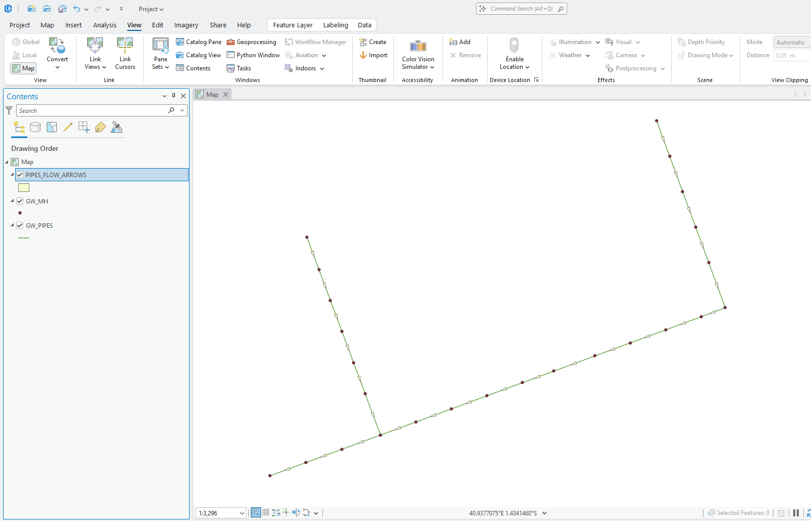
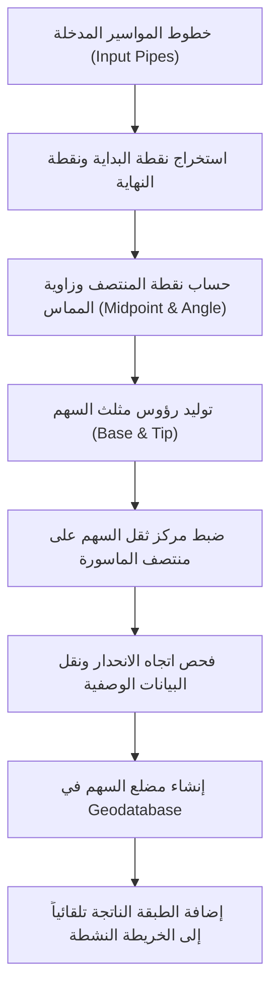

# 🌊 CreateFlowArrow Tool | أداة إنشاء أسهم اتجاه السريان

[](https://www.esri.com/en-us/arcgis/products/arcgis-pro/overview)
[](https://desktop.arcgis.com/en/arcmap/)
[](https://www.python.org/)
[](LICENSE)

> **أداة معالجة جغرافية متقدمة (ArcPy Geoprocessing Tool) لإنشاء أسهم اتجاه السريان وتدقيق جودة شبكات البنية التحتية بالجاذبية (صرف صحي، صرف أمطار، تخفيض مياه جوفية) تلقائياً على كل من ArcMap و ArcGIS Pro.**

---

## 📖 فكرة المشروع والمشكلة الهندسية (Project Concept)

في مشاريع البنية التحتية وشبكات الانحدار والجاذبية (**Gravity Flow Networks**):
- 🌧️ **شبكات تصريف مياه الأمطار والسيول (Stormwater Drainage)**
- 💧 **شبكات تخفيض منسوب المياه الجوفية (Groundwater Lowering / Dewatering)**
- 🚽 **شبكات الصرف الصحي (Sanitary Sewer Networks)**

تعتمد حركة السوائل على الانحدار الطبيعي من المنسوب المرتفع إلى المنسوب المنخفض. ولضمان سلامة النماذج الهيدروليكية وقواعد البيانات الجغرافية، **يجب رسم المواسير هندسياً باتجاه السريان**: من المطبق العلوي (**Upstream Node**) إلى المطبق السفلي (**Downstream Node**).

### التحدي الشائع:
الكثير من البيانات الموردة من الرفع المساحي أو المخططات المستوردة من أوتوكاد (CAD Drawings):
1. **تفتقر تماماً لطبقة تعبر عن اتجاه السريان بوضوح.**
2. **تحتوي على مواسير رُسمت بالخطأ باتجاه عكسي** (من أسفل إلى أعلى)، مما يؤدي لخلل في التحليلات الهيدروليكية وحسابات الشبكة.

### الحل الذي تقدمه الأداة:
تقوم أداة **CreateFlowArrow** بقراءة طبقة خطوط المواسير وبناء طبقة أسهم اتجاه تعبر عن سريان كل ماسورة، حيث يوضع السهم بدقة في منتصف كل ماسورة، ويتجه من **نقطة البداية (Start Point)** إلى **نقطة النهاية (End Point)**.

> 🎯 **أداة تدقيق ورقابة جودة (QA/QC Tool):**
> بمجرد تشغيل الأداة، إذا لاحظ المهندس سهماً يتجه بعكس ميل الأرض أو عكس اتجاه المصب، فهذا **دليل بصري وهندسي قاطع** على أن هذه الماسورة قد رُسمت باتجاه خاطئ ويجب تصحيحها فوراً باستخدام أداة `Flip Line`!

---

## 📸 المعاينة الميدانية (Visual Demonstration - Before & After)

| قبل تشغيل الأداة (شبكة بدون أسهم اتجاهات) | بعد تشغيل الأداة (توليد أسهم السريان بدقة في المنتصف) |
| :---: | :---: |
|  |  |

---

## 🚀 المميزات الرئيسية (Key Features)

- 🔄 **توافق مزدوج كامل (Dual-Platform Compatibility):**
  تعمل بسلاسة مطلقة وبنفس الكفاءة على **ArcMap (Python 2.7)** و **ArcGIS Pro (Python 3.x)** مع الكشف التلقائي عن البيئة.
- 📦 **صندوق أدوات برمجي متكامل (Self-Contained Python Toolbox - `.pyt`):**
  ملف واحد متكامل يضم الواجهة والتحقق والكود البرمجي دون الحاجة لربط ملفات خارجية أو القلق من انكسار المسارات.
- 📐 **محاذاة مركز الثقل الدقيقة (Centroid Midpoint Alignment):**
  تحسب الأداة مركز ثقل مثلث السهم وتضبط إزاحته بحيث يتطابق مركز ثقل السهم بدقة متناهية مع منتصف الماسورة تماماً.
- 🔄 **دعم المنحنيات (Curve Tangent Calculation):**
  حساب زاوية المماس اللحظي عند منتصف الماسورة، لضمان اتجاه السهم بشكل صحيح حتى مع المواسير المنحنية.
- 📋 **نقل البيانات الوصفية (Attribute Preservation):**
  خيار تلقائي لنقل كافة بيانات الماسورة (الرقم، القطر، المادة، الطول، الميل) إلى طبقة الأسهم لسهولة التسمية (Labeling) والاستعلام.
- ⚠️ **فحص المناسيب التلقائي (QA/QC Elevation Inspection):**
  في حال احتواء الطبقة على مناسيب البداية والنهاية (`ST_INV_M` و `END_INV_M`)، تفحص الأداة انحدار الماسورة وتنشئ حقلاً باسم `QA_FLOW_STATUS` ينبهك بالأسهم المعكوسة (`REVERSED`).
- 🗺️ **الإضافة الفورية للخريطة (Auto-Add to Map):**
  تضاف الطبقة الناتجة تلقائياً إلى الخريطة النشطة وجدول المحتويات.

---

## 🛠️ مخطط عمل الأداة (Workflow Diagram)



---

## 💻 طريقة التثبيت والاستخدام (Installation & Usage)

### 1. في برنامج ArcGIS Pro:
1. قم بتحميل أو استنساخ المشروع:
   ```bash
   git clone https://github.com/ahmadibrahim4geo/Create-FlowArrow-Tool.git
   ```
2. افتح مشروعك في **ArcGIS Pro**.
3. في لوحة **Catalog**، انقر بزر الفأرة الأيمن على **Toolboxes** واختر **Add Toolbox**.
4. اختر ملف `CreateFlowArrow.pyt`.
5. افتح الأداة **Create Flow Arrows (إنشاء أسهم اتجاه السريان)**.
6. حدد المدخلات واضغط **Run**.

### 2. في برنامج ArcMap:
1. افتح خريطتك في **ArcMap**.
2. من نافذة **Catalog**، استعرض مجلد المشروع وانقر مباشرة على `CreateFlowArrow.pyt` (أو `CreateFlowArrow.tbx`).
3. املأ البيانات واضغط **OK**.
4. ستظهر طبقة الأسهم مباشرة على الخريطة.

---

## ⚙️ بارامترات الأداة (Parameters)

| # | المعامل | النوع | الحالة | الوصف |
|---|---|---|---|---|
| 1 | **Input Pipes Layer** | Feature Layer | إجباري | طبقة خطوط المواسير (Polyline). |
| 2 | **Output Geodatabase** | Workspace / GDB | إجباري | قاعدة البيانات الجغرافية التي سيتم حفظ الطبقة بها. |
| 3 | **Output Layer Name** | String | إجباري | اسم طبقة أسهم الاتجاه الناتجة (مثال: `PIPES_FLOW_ARROWS`). |
| 4 | **Arrow Base Width** | Double | إجباري | عرض قاعدة السهم بالمتر (افتراضي: `2.0` م). |
| 5 | **Arrow Height/Length** | Double | إجباري | طول / ارتفاع السهم بالمتر (افتراضي: `5.0` م). |
| 6 | **Transfer Attributes** | Boolean | اختياري | خيار نقل سمات وبيانات المواسير إلى طبقة الأسهم. |

---

## 📁 هيكلية ملفات المشروع (Repository Structure)

```text
Create FlowArrow Tool/
├── CreateFlowArrow.pyt          # صندوق الأدوات البرمجي المتكامل (Python Toolbox - الأساسي)
├── CreateFlowArrow.py           # كود السكربت البرمجي المحدث لـ ArcMap و Pro
├── CreateFlowArrow.tbx          # صندوق أدوات ArcMap الكلاسيكي
├── TOOL_DOCUMENTATION.txt       # دليل المستخدم والشرح الفني المفصل بالعربية
├── README.md                    # واجهة المشروع والشرح الكامل على GitHub
├── LICENSE                      # رخصة الاستخدام مفتوحة المصدر (MIT License)
└── .gitignore                   # ملف استبعاد الملفات المؤقتة الخاصة بـ ArcGIS
```

---

## 💡 نصائح تدقيق الجودة (QA/QC Tips)

- **كيف أتعامل مع ماسورة معكوسة؟**
  1. فعّل شريط التعديل (**Editor**).
  2. حدد الماسورة التي يشير سهمها بالعكس.
  3. انقر على أداة تعديل الرؤوس (**Edit Vertices**).
  4. اضغط بالزر الأيمن على الخط واختر **Flip Line** لعكس اتجاه الرسم.
  5. أعد تشغيل الأداة لمشاهدة السهم وقد تم تصحيحه فوراً!

---

## 👨‍💻 المطور والتواصل (Author & Contact)

- **المطور:** أحمد إبراهيم (Ahmad Ibrahim)
- **الصفة:** أخصائي نظم معلومات جغرافية (GIS) وكارتوجرافي ومطور برمجيات مكانية
- **البريد الإلكتروني:** [ahmadibrahim.geo@gmail.com](mailto:ahmadibrahim.geo@gmail.com)
- **حساب GitHub:** [@ahmadibrahim4geo](https://github.com/ahmadibrahim4geo)
- **واتساب (استشارات البنية التحتية والهيدرولوجيا):** [+201111915925](https://wa.me/201111915925)

---

## 📄 الترخيص (License)
هذا المشروع مرخص تحت رخصة **MIT License** - راجع ملف [LICENSE](LICENSE) لمزيد من التفاصيل.

---
**صُنع لخدمة مهندسي ومختصي نظم المعلومات الجغرافية والبنية التحتية.** 🚀
