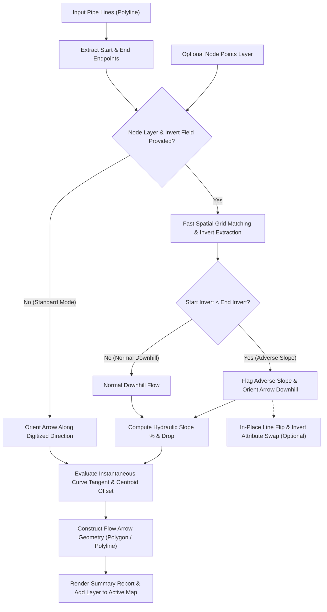

<div align="center">

# 🌊 CreateFlowArrow Tool
### High-Performance Flow Direction Arrows & QA/QC Gravity Networks Engine for ArcGIS
### أداة إنشاء أسهم اتجاه السريان وتدقيق شبكات الانحدار والجاذبية في ArcGIS

[](https://www.esri.com/en-us/arcgis/products/arcgis-pro/overview)
[](https://desktop.arcgis.com/en/arcmap/)
[](https://www.python.org/)
[](LICENSE)

[ 🇬🇧 English Documentation ](#-english-documentation) • [ 🇸🇦 الشرح باللغة العربية ](#-الشرح-باللغة-العربية)

</div>

---

# 🇬🇧 English Documentation

## 📖 Overview & Engineering Concept

In civil engineering and municipal infrastructure GIS projects, gravity-driven conveyance networks:
- 🌧️ **Stormwater Drainage & Flood Control Networks**
- 💧 **Groundwater Lowering / Dewatering Networks**
- 🚽 **Sanitary Sewer & Wastewater Networks**

Fluid conveyance relies strictly on topographical gravity gradient—moving naturally from higher hydraulic grade to lower hydraulic grade ($Z_{upstream} > Z_{downstream}$). To ensure the validity of GIS topology, hydraulic modeling (e.g. SWMM, SewerGEMS, InfoWorks ICM), and spatial asset management:
**Pipe polyline features must be digitized strictly in the true direction of physical flow (from Upstream Manhole to Downstream Manhole).**

### The Industry Challenge:
Networks imported from AutoCAD civil drawings, legacy GIS databases, or surveyed field CAD lines frequently suffer from:
1. **No visual flow arrow symbology**, making manual flow direction verification exhausting across thousands of pipes.
2. **Reversed digitizing direction errors** (pipes drawn uphill, from downstream to upstream), which breaks hydraulic network traces, disconnects watershed routing, and corrupts network calculations.

### The Solution:
**CreateFlowArrow** is an advanced, high-performance standalone ArcGIS Python Toolbox (`.pyt`) that:
1. Generates geometric flow direction arrows (**Polygon** triangles or **Polyline** open V-arrows) aligned precisely at each pipe's mathematical **midpoint** (or custom placement ratio: 25%, 50%, 75%).
2. Aligns arrow center-of-gravity (centroid) with the pipe line to eliminate visual distortion.
3. Calculates instantaneous **tangents along curves** to guarantee smooth flow orientation even on curved conduit alignments.
4. **Smart Node Invert & Slope Percentage Engine:**
   - Activated strictly when the user provides the **Optional Node Points Layer** and selects the **Node Invert Elevation Field**.
   - Uses high-speed spatial grid hashing ($O(1)$) to snap pipe endpoints to node points.
   - Computes **Start Invert**, **End Invert**, **Invert Drop / Head**, **Pipe Length**, **Hydraulic Slope Percentage (`SLOPE_PCT %`)**, and **Slope Per-Mil (`SLOPE_PER_MIL ‰`)**.
   - Directs flow arrows downhill from higher invert to lower invert and flags adverse slopes (`REVERSED`).
5. **Standard Digitized Direction Mode:**
   - When node points are not provided, flow direction arrows are generated purely according to the pipe's digitized line direction.
6. **In-Place Auto-Flip & Attribute Swapping:**
   - Reverses adverse/uphill pipe polylines in-place directly in the source layer (including multi-part geometries).
   - Optionally swaps `START_INV` and `END_INV` attribute values on flipped pipes to guarantee 100% attribute consistency.
7. **Progress Bar & Performance Scaling:** Built-in `arcpy.SetProgressor` visual feedback and formatted execution summary report.

---

## 📸 Visual Demonstration (Before & After)

| Before Tool Execution (Raw lines with unknown flow directions) | After Tool Execution (Flow arrows aligned with downhill gravity flow) |
| :---: | :---: |
|  |  |

---

## 🚀 Key Features

- 🔄 **Dual-Platform Native Compatibility:**
  Seamlessly runs in both **ArcMap 10.1+ (Python 2.7)** and **ArcGIS Pro 2.x / 3.x (Python 3.x)** with automatic environment detection (`arcpy.mp` vs `arcpy.mapping`).
- 📦 **Self-Contained Python Toolbox (`.pyt`):**
  Zero complex dependencies or broken script paths. Double-click and execute directly.
- 📐 **Centroid Midpoint Alignment:**
  Calculates the exact triangle centroid $(X_c, Y_c)$ and applies an analytical offset so the arrow's center of gravity coincides flawlessly with the line placement point.
- 🔀 **Flexible Geometry Outputs (Polygon vs. Polyline):**
  Generate closed triangular arrowheads (`Polygon`) or open cartographic V-arrows (`Polyline`).
- 🎯 **Slope Percentage & Invert Analysis (On Node Points Input):**
  When a node points layer and invert field are specified, the tool computes hydraulic slope percentage (`SLOPE_PCT`), slope per mil (`SLOPE_PER_MIL`), and head drop.
- 🔄 **In-Place Auto-Flip:**
  Optionally reverses the vertex order of uphill pipe polylines in-place so your source network geometry becomes 100% hydraulically correct.
- 🔄 **Local Curve Tangent Calculation:**
  Evaluates the instantaneous slope between 49% and 51% along the curve, avoiding crude endpoint straight-line simplifications.
- 📋 **Full Attribute Preservation:**
  Inherits all original pipe attributes (diameter, material, length, slope) with an `ORIG_FID` key.
- ⚡ **O(1) Spatial Hashing & Progressor:**
  Sub-second spatial queries even across 100,000+ points and real-time step progress reporting.
- 🗺️ **Automatic Add to Active Map:**
  Dynamically loads the generated arrow layer into the active Table of Contents (TOC) / Contents pane.
- 🧪 **Bundled Sample Training Data (`data/`):**
  Includes a sample File Geodatabase (`data/TEST.gdb`) and Shapefiles (`data/sample_gravity_pipes.shp`, `data/sample_manhole_nodes.shp`) for immediate testing.

---

## 🛠️ Engineering Workflow Architecture



---

## 💻 Installation & Usage Guide

### 1. ArcGIS Pro:
1. Clone or download the repository:
   ```bash
   git clone https://github.com/ahmadibrahim4geo/Create-FlowArrow-Tool.git
   ```
2. Open your project in **ArcGIS Pro**.
3. In the **Catalog** pane, right-click **Toolboxes** and select **Add Toolbox**.
4. Browse to the folder and pick `CreateFlowArrow.pyt`.
5. Open **Create Flow Direction Arrows**.
6. Set your inputs and click **Run**.

### 2. ArcMap:
1. Open your map document in **ArcMap**.
2. In the **Catalog** window, navigate to Folder Connections and open `CreateFlowArrow.pyt`.
3. Fill in the parameters and click **OK**.
4. The flow arrows will appear immediately in your Data Frame.

---

## ⚙️ Parameters Reference Table

| # | Parameter | Data Type | Required / Optional | Default Value | Description |
|---|---|---|---|---|---|
| **0** | **Input Pipe Lines** | Feature Layer (Polyline) | Required | — | Input gravity pipe network lines layer. |
| **1** | **Output Geodatabase or Workspace** | Workspace / GDB | Required | — | Target File Geodatabase (.gdb) to store the arrows layer. |
| **2** | **Output Layer Name** | String | Required | `Flow_Direction_Arrows` | Name of the output arrow feature class. |
| **3** | **Output Geometry Type** | String (Choice) | Required | `Polygon` | Geometry type: `Polygon` (closed triangle) or `Polyline` (open V-arrow). |
| **4** | **Arrow Base Width (Meters)** | Double | Required | `2.0` | Width of the arrow base in map linear units (meters). |
| **5** | **Arrow Height / Length (Meters)** | Double | Required | `5.0` | Length of the arrow from base to tip in map units (meters). |
| **6** | **Transfer Pipe Attributes** | Boolean | Optional | `True` | Copy all original pipe attributes to output arrows with `ORIG_FID`. |
| **7** | **Optional Node Points Layer** | Feature Layer (Point) | Optional | — | Manhole/junction points layer snapped to pipe endpoints. |
| **8** | **Node Invert Elevation Field** | Field (Numeric) | Optional | — | Invert elevation field (enables slope percentage & invert calculation). |
| **9** | **Auto-Flip Reversed Pipe Lines** | Boolean | Optional | `False` | Automatically flips reversed source pipe polylines in-place to follow gravity. |
| **10** | **Node Snapping Tolerance (Meters)** | Double | Optional | `1.5` | Search radius for matching pipe endpoints with node manhole points. |
| **11** | **Arrow Placement Along Pipe** | String (Choice) | Optional | `Midpoint (50%)` | Position along pipe: `Midpoint (50%)`, `Quarter (25%)`, or `Three-Quarters (75%)`. |
| **12** | **Swap Invert Attributes on Flip** | Boolean | Optional | `True` | Swaps Start/End invert fields in pipe table when flipped in-place. |
| **13** | **Output Flow Arrows Layer** | Feature Class | Derived (Output) | — | Derived output for ModelBuilder and automated script chains. |

---

## 📊 Output Attribute Schema & QA/QC Fields

| Field Name | Type | Description |
|---|---|---|
| `ORIG_FID` | LONG | Original pipe feature ObjectID / FID. |
| `QA_FLOW_STATUS` | TEXT (100) | Detailed human-readable hydraulic flow & slope description. |
| `QA_SEVERITY` | TEXT (30) | Standard status: `NORMAL_DOWNHILL`, `ADVERSE_SLOPE`, `ZERO_SLOPE`, `PARTIAL_ELEVATION`, `DIGITIZED_ONLY`. |
| `START_INV` | DOUBLE | Upstream / Start Invert Elevation (m) - *Calculated when Node Points are provided*. |
| `END_INV` | DOUBLE | Downstream / End Invert Elevation (m) - *Calculated when Node Points are provided*. |
| `INVERT_DROP` | DOUBLE | Invert drop / head: $Z_{start} - Z_{end}$ (m) - *Calculated when Node Points are provided*. |
| `PIPE_LEN` | DOUBLE | Pipe geometric length (m). |
| `SLOPE_PCT` | DOUBLE | Hydraulic slope percentage: $\frac{Drop}{Length} \times 100$ (%) - *Calculated when Node Points are provided*. |
| `SLOPE_PER_MIL` | DOUBLE | Hydraulic slope per mil: $\frac{Drop}{Length} \times 1000$ (‰) - *Calculated when Node Points are provided*. |
| `FLIPPED` | TEXT (10) | `YES` if pipe geometry was auto-flipped in-place, else `NO`. |

---

## 🧪 Sample Training Dataset (`data/`)

The repository includes a ready-to-use dataset in the `data/` directory:
- **`TEST.gdb`**: File Geodatabase containing:
  - `GW_PIPES`: Groundwater drainage pipes with hydraulic properties.
  - `GW_MH`: Manhole points with the `INVERT_M` elevation field.
- **`sample_gravity_pipes.shp`**: Sample shapefile containing 4 normal pipes and 2 intentionally reversed pipes (`P-103` & `P-105`).
- **`sample_manhole_nodes.shp`**: Manholes snapped to pipe ends with invert elevations.
- See `data/README.md` for a quick step-by-step walkthrough.

---

# 🇸🇦 الشرح باللغة العربية

## 📖 فكرة المشروع والمشكلة الهندسية (Project Concept)

في مشاريع البنية التحتية وشبكات الانحدار والجاذبية (**Gravity Flow Networks**):
- 🌧️ **شبكات تصريف مياه الأمطار والسيول (Stormwater Drainage)**
- 💧 **شبكات تخفيض منسوب المياه الجوفية (Groundwater Lowering / Dewatering)**
- 🚽 **شبكات الصرف الصحي (Sanitary Sewer Networks)**

تعتمد حركة السوائل على الانحدار الطبيعي من المنسوب المرتفع إلى المنسوب المنخفض ($Z_{upstream} > Z_{downstream}$). ولضمان سلامة النماذج الهيدروليكية وقواعد البيانات الجغرافية، **يجب رسم المواسير هندسياً باتجاه السريان**: من المطبق العلوي (**Upstream Node**) إلى المطبق السفلي (**Downstream Node**).

### التحدي الشائع:
الكثير من البيانات الموردة من الرفع المساحي أو المخططات المستوردة من أوتوكاد (CAD Drawings):
1. **تفتقر تماماً لطبقة تعبر عن اتجاه السريان بوضوح.**
2. **تحتوي على مواسير رُسمت بالخطأ باتجاه عكسي** (من أسفل إلى أعلى)، مما يؤدي لخلل في التحليلات الهيدروليكية وحسابات الشبكة.

### الحل المطور:
تقوم أداة **CreateFlowArrow** ببناء محرك متكامل لتدقيق الجودة الهندسية وإنشاء طبقة أسهم اتجاه السريان:
1. **وضع السهم بدقة متناهية** في منتصف الماسورة (أو بنسب مخصصة: 25%، 50%، 75%).
2. **محاذاة مركز ثقل السهم** هندسياً مع مسار الخط لمنع أي تشوه بصري.
3. **حساب مماس المنحنيات اللحظي** لضمان دقة اتجاه الأسهم حتى في خطوط المواسير المنحنية.
4. **حساب الميل والمناسيب الذكي عند إدخال طبقة النقاط:**
   - **عند تحديد طبقة نقاط المطابق وحقل المنسوب:** تقوم الأداة بحساب منسوب البداية والنهاية، فرق المنسوب (`INVERT_DROP`)، ونسبة الميل المئوية (`SLOPE_PCT %`) والميل في الألف (`SLOPE_PER_MIL ‰`)، وتوجيه الأسهم نحو المنخفض آلياً ورصد الميل المعاكس (`REVERSED`).
   - **عند عدم إدخال طبقة النقاط:** تُنشئ الأداة أسهم الاتجاه بناءً على اتجاه رسم الخط المباشر (Digitized Direction) وتتخطى حساب المناسيب والميول تلقائياً.
5. **التصحيح التلقائي المزدوج (In-Place Auto-Flip & Invert Swap):**
   - عكس اتجاه رسم الخطوط المعكوسة في الطبقة الأصلية فوراً.
   - تبديل قيم مناسيب البداية والنهاية في جدول البيانات لضمان تطابق البيانات الوصفية مع الرسم الجديد.
6. **شريط تقدم تفاعلي وتقرير ختامي ملخص** يوضح الإحصائيات الهيدروليكية وزمن المعالجة بدقة.

---

## 🚀 المميزات الرئيسية (Key Features)

- 🔄 **توافق مزدوج كامل (Dual-Platform Compatibility):**
  تعمل بسلاسة مطلقة وبنفس الكفاءة على **ArcMap (Python 2.7)** و **ArcGIS Pro (Python 3.x)** مع الكشف التلقائي عن البيئة.
- 📦 **صندوق أدوات برمجي متكامل (Self-Contained Python Toolbox - `.pyt`):**
  أداة مدمجة وموحدة دون الحاجة لربط ملفات خارجية أو إعداد مسارات يدوية.
- 📐 **محاذاة مركز الثقل الدقيقة (Centroid Midpoint Alignment):**
  تحسب الأداة مركز ثقل مثلث السهم وتضبط إزاحته ليتطابق مع خط الماسورة تماماً.
- 🔀 **خيارات هندسية متعددة للمخرج (Polygon / Polyline):**
  إمكانية اختيار نوع هندسة الأسهم: مضلع مغلق (`Polygon`) أو سهم خطي مفتوح (`Polyline`).
- 🎯 **حساب الميل النسبة المئوية عند إدخال النقاط والمناسيب:**
  حساب نسبة الميل `SLOPE_PCT` والميل في الألف `SLOPE_PER_MIL` وفروق المناسيب حصرياً عند إدخال طبقة النقاط وحقل المنسوب.
- 🔄 **التصحيح التلقائي (Auto-Flip):**
  تصحيح هندسة الخطوط المعكوسة وتبديل قيم المناسيب لمنع أي تضارب بين الرسم والبيانات.
- ⚡ **أداء فائق الفاعلية وفهرسة شبكية O(1):**
  معالجة عشرات الآلاف من المواسير والمطابق في ثوانٍ معدودة مع شريط تقدم `SetProgressor`.
- 🗺️ **الإضافة الفورية للخريطة (Auto-Add to Map):**
  تضاف الطبقة الناتجة تلقائياً إلى الخريطة النشطة وجدول المحتويات.
- 🧪 **حزمة بيانات تدريبية مدمجة (`data/`):**
  قاعدة بيانات جغرافية `TEST.gdb` وملفات shapefile جاهزة فوراً للتجربة والاختبار.

---

## ⚙️ بارامترات الأداة (Parameters Reference)

| # | المعامل (Parameter) | النوع (Type) | الحالة | الوصف |
|---|---|---|---|---|
| **0** | **Input Pipe Lines** | Feature Layer (Polyline) | إجباري | طبقة خطوط شبكة المواسير المفتوحة بالخريطة. |
| **1** | **Output Geodatabase or Workspace** | Workspace / GDB | إجباري | مسار قاعدة البيانات الجغرافية (.gdb) لحفظ الطبقة الناتجة. |
| **2** | **Output Layer Name** | String | إجباري | اسم طبقة أسهم الاتجاه الناتجة (افتراضي: `Flow_Direction_Arrows`). |
| **3** | **Output Geometry Type** | String (Choice) | إجباري | نوع هندسة السهم: مضلع مغلق (`Polygon`) أو سهم خطي مفتوح (`Polyline`). |
| **4** | **Arrow Base Width (Meters)** | Double | إجباري | عرض قاعدة مثلث السهم بالمتر (افتراضي: `2.0` م). |
| **5** | **Arrow Height / Length (Meters)** | Double | إجباري | ارتفاع / طول السهم بالمتر (افتراضي: `5.0` م). |
| **6** | **Transfer Pipe Attributes** | Boolean | اختياري | نقل سمات وبيانات المواسير الأصلية إلى طبقة الأسهم (افتراضي: `True`). |
| **7** | **Optional Node Points Layer** | Feature Layer (Point) | اختياري | طبقة نقاط المطابق الملحقة بنهايات المواسير (تُفعّل حساب المناسيب والميول). |
| **8** | **Node Invert Elevation Field** | Field (Numeric) | اختياري | حقل منسوب القاع بالنقاط لحساب الميل المئوي وتوجيه السهم وفق الجاذبية. |
| **9** | **Auto-Flip Reversed Pipe Lines** | Boolean | اختياري | عكس اتجاه رسم المواسير المعكوسة هندسياً بالطبقة الأصلية فوراً. |
| **10** | **Node Snapping Tolerance (Meters)** | Double | اختياري | مسافة البحث والالتقاط بالمتر لمطابقة نهايات المواسير مع المطابق (افتراضي: `1.5` م). |
| **11** | **Arrow Placement Along Pipe** | String (Choice) | اختياري | موضع السهم: في المنتصف (`Midpoint (50%)`)، الربع الأول (`25%`)، أو الربع الأخير (`75%`). |
| **12** | **Swap Invert Attributes on Flip** | Boolean | اختياري | تبديل قيم حقول مناسيب البداية والنهاية عند عكس الخطوط المعكوسة (افتراضي: `True`). |
| **13** | **Output Flow Arrows Layer** | Feature Class | مشتق (Derived) | مخرج برمجي آلي لربط الأداة في نماذج ModelBuilder وسكربتات الأتمتة. |

---

## 📊 حقول المخرجات وجدول تدقيق الجودة الهندسية

| الحقل | النوع | الوصف الفني |
|---|---|---|
| `ORIG_FID` | LONG | المعرف الفريد للماسورة الأصلية. |
| `QA_FLOW_STATUS` | TEXT (100) | وصف حالة السريان والميل الهيدروليكي وفروق المناسيب. |
| `QA_SEVERITY` | TEXT (30) | كود الحالة القياسي: `NORMAL_DOWNHILL`, `ADVERSE_SLOPE`, `ZERO_SLOPE`, `PARTIAL_ELEVATION`, `DIGITIZED_ONLY`. |
| `START_INV` | DOUBLE | منسوب قاع بداية الماسورة (م) - *يُحسب عند إدخال طبقة النقاط*. |
| `END_INV` | DOUBLE | منسوب قاع نهاية الماسورة (م) - *يُحسب عند إدخال طبقة النقاط*. |
| `INVERT_DROP` | DOUBLE | فرق المنسوب الهيدروليكي بين البداية والنهاية (م) - *يُحسب عند إدخال طبقة النقاط*. |
| `PIPE_LEN` | DOUBLE | طول الماسورة الحقيقي (م). |
| `SLOPE_PCT` | DOUBLE | نسبة الميل الهيدروليكي المئوية: $(Drop / Length) \times 100$ (%) - *تُحسب عند إدخال طبقة النقاط*. |
| `SLOPE_PER_MIL` | DOUBLE | نسبة الميل في الألف: $(Drop / Length) \times 1000$ (‰) - *تُحسب عند إدخال طبقة النقاط*. |
| `FLIPPED` | TEXT (10) | وسم `YES` إذا تم تصحيح وعكس اتجاه رسم الماسورة، وإلا `NO`. |

---

## 📁 هيكلية ملفات المشروع (Repository Structure)

```text
Create FlowArrow Tool/
├── assets/                      # مجلد الصور وملفات الوسائط (Before/After)
│   ├── before.png               # صورة المعاينة قبل تشغيل الأداة
│   └── after.png                # صورة المعاينة بعد توليد الأسهم
├── data/                        # بيانات جغرافية اختبارية جاهزة للتدريب
│   ├── TEST.gdb/                # قاعدة بيانات حقيقية بها شبكة مياه جوفية ومطابق بمناسيب
│   ├── sample_gravity_pipes.shp # خطوط مواسير اختبارية (بها مواسير معكوسة)
│   ├── sample_manhole_nodes.shp # نقاط مطابق اختبارية بمناسيب Inverts حقيقية
│   └── README.md                # دليل استخدام البيانات التدريبية
├── CreateFlowArrow.pyt          # صندوق الأدوات الموحد لـ ArcMap و ArcGIS Pro (Python Toolbox)
├── CreateFlowArrow.py           # كود السكربت البرمجي المستقل للمطورين وبيئات الأتمتة
├── index.html                   # صفحة الويب التفاعلية لعرض وتوثيق الأداة
├── TOOL_DOCUMENTATION.txt       # دليل المستخدم والشرح الفني المفصل بالعربية
├── README.md                    # واجهة المشروع والشرح الكامل على GitHub
├── LICENSE                      # رخصة الاستخدام مفتوحة المصدر (MIT License)
└── .gitignore                   # ملف استبعاد الملفات المؤقتة الخاصة بـ ArcGIS
```

---

## 👨‍💻 المطور والتواصل (Author & Contact)

- **المطور:** أحمد إبراهيم (Ahmad Ibrahim)
- **الصفة:** أخصائي نظم معلومات جغرافية (GIS) وكارتوجرافي ومطور برمجيات مكانية
- **البريد الإلكتروني:** [ahmadibrahim.geo@gmail.com](mailto:ahmadibrahim.geo@gmail.com)
- **حساب GitHub:** [@ahmadibrahim4geo](https://github.com/ahmadibrahim4geo)
- **واتساب (استشارات البنية التحتية والهيدرولوجيا):** [+201111915925](https://wa.me/201111915925)

---

## 📄 الترخيص (License)
هذا المشروع مرخص تحت رخصة **MIT License** - راجع ملف [LICENSE](LICENSE) لمزيد من التفاصيل.

---
**صُنع لخدمة مهندسي ومختصي نظم المعلومات الجغرافية والبنية التحتية حول العالم.** 🚀
