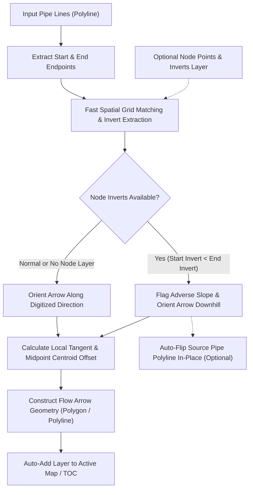
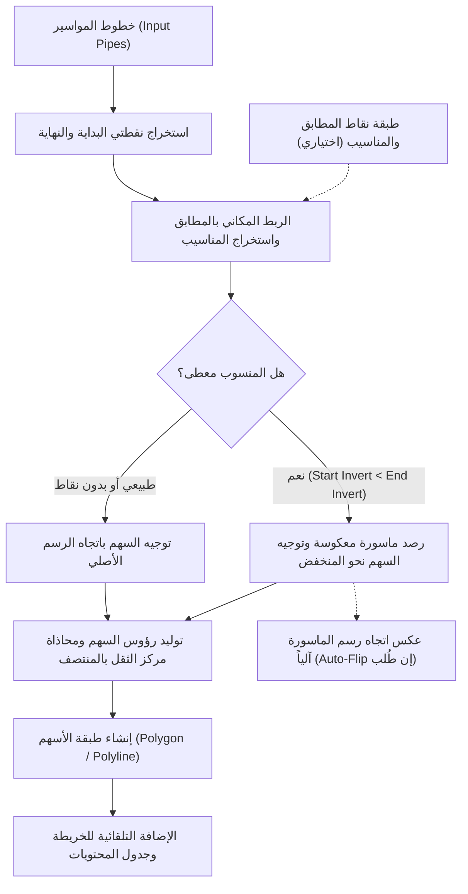

<div align="center">

# 🌊 CreateFlowArrow Tool
### Flow Direction Arrows & QA/QC Gravity Networks Engine for ArcGIS
### أداة إنشاء أسهم اتجاه السريان وتدقيق شبكات الانحدار والجاذبية في ArcGIS

[](https://www.esri.com/en-us/arcgis/products/arcgis-pro/overview)
[](https://desktop.arcgis.com/en/arcmap/)
[](https://www.python.org/)
[](LICENSE)

[ 🇬🇧 English Documentation ](#-english-documentation) • [ 🇸🇦 الشرح باللغة العربية ](#-الشرح-باللغة-العربية)

</div>

---

# 🇬🇧 English Documentation

## 📖 Overview & Engineering Concept

In civil engineering and municipal infrastructure GIS projects, gravity-driven conveyance networks:
- 🌧️ **Stormwater Drainage & Flood Control Networks**
- 💧 **Groundwater Lowering / Dewatering Networks**
- 🚽 **Sanitary Sewer & Wastewater Networks**

Fluid conveyance relies strictly on topographical gravity gradient—moving naturally from higher hydraulic grade to lower hydraulic grade ($Z_{upstream} > Z_{downstream}$). To ensure the validity of GIS topology, hydraulic modeling (e.g. SWMM, SewerGEMS, InfoWorks ICM), and spatial asset management:
**Pipe polyline features must be digitized strictly in the true direction of physical flow (from Upstream Manhole to Downstream Manhole).**

### The Industry Challenge:
Networks imported from AutoCAD civil drawings, legacy GIS databases, or surveyed field CAD lines frequently suffer from:
1. **No visual flow arrow symbology**, making manual flow direction verification exhausting across thousands of pipes.
2. **Reversed digitizing direction errors** (pipes drawn uphill, from downstream to upstream), which breaks hydraulic network traces, disconnects watershed routing, and corrupts network calculations.

### The Solution:
**CreateFlowArrow** is an advanced, standalone ArcGIS Python Toolbox (`.pyt`) that:
1. Generates geometric flow direction arrows (**Polygon** triangles or **Polyline** open V-arrows) aligned precisely at each pipe's mathematical **midpoint**.
2. Aligns arrow center-of-gravity (centroid) with the pipe line to eliminate visual distortion.
3. Calculates instantaneous **tangents along curves** to guarantee smooth flow orientation even on curved conduit alignments.
4. **Smart Node Invert Alignment:** Matches pipe endpoints with optional manhole/node points, comparing actual invert elevations ($Z_{start}$ vs $Z_{end}$) to ensure arrows always point in the true downhill direction.
5. **Auto-Flip Reversed Pipe Lines:** Optionally reverses the digitization vertices of uphill/reversed pipes in-place directly within the source layer, correcting errors with a single click.

---

## 📸 Visual Demonstration (Before & After)

| Before Tool Execution (Raw lines with unknown flow directions) | After Tool Execution (Flow arrows aligned with downhill gravity flow) |
| :---: | :---: |
|  |  |

---

## 🚀 Key Features

- 🔄 **Dual-Platform Native Compatibility:**
  Seamlessly runs in both **ArcMap 10.1+ (Python 2.7)** and **ArcGIS Pro 2.x / 3.x (Python 3.x)** with automatic environment detection.
- 📦 **Self-Contained Python Toolbox (`.pyt`):**
  Zero complex dependencies or broken script paths. Double-click and execute directly.
- 📐 **Centroid Midpoint Alignment:**
  Calculates the exact triangle centroid $(X_c, Y_c)$ and applies an analytical offset so the arrow's center of gravity coincides flawlessly with the 50% line midpoint.
- 🔀 **Flexible Geometry Outputs (Polygon vs. Polyline):**
  Generate closed triangular arrowheads (`Polygon`) or open cartographic V-arrows (`Polyline`).
- 🎯 **Smart Node Invert Elevation Alignment:**
  Accepts an optional manhole point layer with an Invert Elevation field. High-speed spatial grid hashing snaps endpoints to manholes, routing arrows from higher elevation to lower elevation.
- 🔄 **In-Place Auto-Flip Correction:**
  Optionally reverses the vertex order of uphill pipe polylines in-place so your source network geometry becomes 100% hydraulically correct.
- 🔄 **Local Curve Tangent Calculation:**
  Evaluates the instantaneous slope between 49% and 51% along the curve, avoiding crude endpoint straight-line simplifications.
- 📋 **Full Attribute Preservation:**
  Inherits all original pipe attributes (diameter, material, length, slope) with an `ORIG_FID` key.
- ⚠️ **Automated QA/QC Elevation Inversion Reporting:**
  Populates `QA_FLOW_STATUS`, `START_INV`, `END_INV`, and `INVERT_DROP` fields to flag adverse slopes (`REVERSED`).
- 🗺️ **Automatic Add to Active Map:**
  Dynamically loads the generated arrow layer into the active Table of Contents (TOC) / Contents pane.
- 🧪 **Bundled Sample Training Data (`data/`):**
  Includes a sample File Geodatabase (`data/TEST.gdb`) and Shapefiles (`data/sample_gravity_pipes.shp`, `data/sample_manhole_nodes.shp`) for immediate testing.

---

## 🛠️ Engineering Workflow Architecture



---

## 💻 Installation & Usage Guide

### 1. ArcGIS Pro:
1. Clone or download the repository:
   ```bash
   git clone https://github.com/ahmadibrahim4geo/Create-FlowArrow-Tool.git
   ```
2. Open your project in **ArcGIS Pro**.
3. In the **Catalog** pane, right-click **Toolboxes** and select **Add Toolbox**.
4. Browse to the folder and pick `CreateFlowArrow.pyt`.
5. Open **Create Flow Direction Arrows**.
6. Set your inputs and click **Run**.

### 2. ArcMap:
1. Open your map document in **ArcMap**.
2. In the **Catalog** window, navigate to Folder Connections and open `CreateFlowArrow.pyt`.
3. Fill in the parameters and click **OK**.
4. The flow arrows will appear immediately in your Data Frame.

---

## ⚙️ Parameters Reference Table

| # | Parameter | Data Type | Required / Optional | Default Value | Description |
|---|---|---|---|---|---|
| **0** | **Input Pipe Lines** | Feature Layer (Polyline) | Required | — | Input gravity pipe network lines layer. |
| **1** | **Output Geodatabase or Workspace** | Workspace / GDB | Required | — | Target File Geodatabase (.gdb) to store the arrows layer. |
| **2** | **Output Layer Name** | String | Required | `Flow_Direction_Arrows` | Name of the output arrow feature class. |
| **3** | **Output Geometry Type** | String (Choice) | Required | `Polygon` | Geometry type: `Polygon` (closed triangle) or `Polyline` (open V-arrow). |
| **4** | **Arrow Base Width (Meters)** | Double | Required | `2.0` | Width of the arrow base in map linear units (meters). |
| **5** | **Arrow Height / Length (Meters)** | Double | Required | `5.0` | Length of the arrow from base to tip in map units (meters). |
| **6** | **Transfer Pipe Attributes** | Boolean | Optional | `True` | Copy all original pipe attributes to output arrows with `ORIG_FID`. |
| **7** | **Optional Node Points Layer** | Feature Layer (Point) | Optional | — | Manhole/junction points layer snapped to pipe endpoints. |
| **8** | **Node Invert Elevation Field** | Field (Numeric) | Optional | — | Invert elevation field (enables flow verification: Higher $Z$ to Lower $Z$). |
| **9** | **Auto-Flip Reversed Pipe Lines** | Boolean | Optional | `False` | Automatically flips reversed source pipe polylines in-place to follow gravity. |

---

## 🧪 Sample Training Dataset (`data/`)

The repository includes a ready-to-use dataset in the `data/` directory:
- **`TEST.gdb`**: File Geodatabase containing:
  - `GW_PIPES`: Groundwater drainage pipes with hydraulic properties.
  - `GW_MH`: Manhole points with the `INVERT_M` elevation field.
- **`sample_gravity_pipes.shp`**: Sample shapefile containing 4 normal pipes and 2 intentionally reversed pipes (`P-103` & `P-105`).
- **`sample_manhole_nodes.shp`**: Manholes snapped to pipe ends with invert elevations.
- See `data/README.md` for a quick step-by-step walkthrough.

---

# 🇸🇦 الشرح باللغة العربية

## 📖 فكرة المشروع والمشكلة الهندسية (Project Concept)

في مشاريع البنية التحتية وشبكات الانحدار والجاذبية (**Gravity Flow Networks**):
- 🌧️ **شبكات تصريف مياه الأمطار والسيول (Stormwater Drainage)**
- 💧 **شبكات تخفيض منسوب المياه الجوفية (Groundwater Lowering / Dewatering)**
- 🚽 **شبكات الصرف الصحي (Sanitary Sewer Networks)**

تعتمد حركة السوائل على الانحدار الطبيعي من المنسوب المرتفع إلى المنسوب المنخفض. ولضمان سلامة النماذج الهيدروليكية وقواعد البيانات الجغرافية، **يجب رسم المواسير هندسياً باتجاه السريان**: من المطبق العلوي (**Upstream Node**) إلى المطبق السفلي (**Downstream Node**).

### التحدي الشائع:
الكثير من البيانات الموردة من الرفع المساحي أو المخططات المستوردة من أوتوكاد (CAD Drawings):
1. **تفتقر تماماً لطبقة تعبر عن اتجاه السريان بوضوح.**
2. **تحتوي على مواسير رُسمت بالخطأ باتجاه عكسي** (من أسفل إلى أعلى)، مما يؤدي لخلل في التحليلات الهيدروليكية وحسابات الشبكة.

### الحل الذي تقدمه الأداة:
تقوم أداة **CreateFlowArrow** بقراءة طبقة خطوط المواسير وبناء طبقة أسهم اتجاه تعبر عن سريان كل ماسورة، حيث يوضع السهم بدقة في منتصف كل ماسورة، ويتجه من **نقطة البداية (Start Point)** إلى **نقطة النهاية (End Point)** أو يتبع مسار مناسيب المطابق آلياً من الأعلى للأسفل مع إمكانية تصحيح رسم الخطوط المعكوسة فوراً.

> 🎯 **أداة تدقيق ورقابة جودة (QA/QC Tool):**
> بمجرد تشغيل الأداة، إذا لاحظ المهندس سهماً يتجه بعكس ميل الأرض أو عكس اتجاه المصب، فهذا **دليل بصري وهندسي قاطع** على أن هذه الماسورة قد رُسمت باتجاه خاطئ ويجب تصحيحها فوراً!

---

## 🚀 المميزات الرئيسية (Key Features)

- 🔄 **توافق مزدوج كامل (Dual-Platform Compatibility):**
  تعمل بسلاسة مطلقة وبنفس الكفاءة على **ArcMap (Python 2.7)** و **ArcGIS Pro (Python 3.x)** مع الكشف التلقائي عن البيئة.
- 📦 **صندوق أدوات برمجي متكامل (Self-Contained Python Toolbox - `.pyt`):**
  أداة مدمجة وموحدة بواجهة إنجليزية بالكامل (`Create Flow Direction Arrows`) دون الحاجة لربط ملفات خارجية.
- 📐 **محاذاة مركز الثقل الدقيقة (Centroid Midpoint Alignment):**
  تحسب الأداة مركز ثقل مثلث السهم وتضبط إزاحته بحيث يتطابق مركز ثقل السهم بدقة متناهية مع منتصف الماسورة تماماً.
- 🔀 **خيارات هندسية متعددة للمخرج (Polygon / Polyline):**
  إمكانية اختيار نوع هندسة الأسهم الناتجة: مضلع مغلق (`Polygon`) أو سهم خطي مفتوح (`Polyline`) حسب متطلبات الإخراج الكارتوجرافي.
- 🎯 **الربط الذكي بنقاط المطابق ومناسيب القاع (Node Invert Alignment):**
  دعم اختياري لطبقة نقاط المطابق وحقل المناسيب؛ تقوم الخوارزمية بالتقاط المطابق عند نهايات كل ماسورة وتوجيه الأسهم تلقائياً من المنسوب المرتفع إلى المنخفض.
- 🔄 **التصحيح التلقائي لرسم المواسير المعكوسة (Auto-Flip Reversed Pipes):**
  خيار تلقائي ذكي لعكس اتجاه رسم المواسير المعكوسة هندسياً في الطبقة الأصلية مباشرة لتتوافق مع الجاذبية دون الحاجة لتدخل يدوي!
- 🔄 **دعم المنحنيات (Curve Tangent Calculation):**
  حساب زاوية المماس اللحظي عند منتصف الماسورة، لضمان اتجاه السهم بشكل صحيح حتى مع المواسير المنحنية.
- 📋 **نقل البيانات الوصفية (Attribute Preservation):**
  خيار تلقائي لنقل كافة بيانات الماسورة (الرقم، القطر، المادة، الطول، الميل) إلى طبقة الأسهم لسهولة التسمية (Labeling) والاستعلام.
- ⚠️ **فحص المناسيب التلقائي (QA/QC Elevation Inspection):**
  فحص الانحدار وكشف المواسير المعكوسة تلقائياً وتوثيق الفروق الهيدروليكية وحقول `START_INV` و `END_INV` و `INVERT_DROP`.
- 🗺️ **الإضافة الفورية للخريطة (Auto-Add to Map):**
  تضاف الطبقة الناتجة تلقائياً إلى الخريطة النشطة وجدول المحتويات.
- 🧪 **حزمة بيانات تدريبية مدمجة (`data/`):**
  شبكة مواسير ومطابق جاهزة فوراً للتجربة والتدريب.

---

## 🛠️ مخطط عمل الأداة (Workflow Diagram)



---

## 💻 طريقة التثبيت والاستخدام (Installation & Usage)

### 1. في برنامج ArcGIS Pro:
1. قم بتحميل أو استنساخ المشروع:
   ```bash
   git clone https://github.com/ahmadibrahim4geo/Create-FlowArrow-Tool.git
   ```
2. افتح مشروعك في **ArcGIS Pro**.
3. في لوحة **Catalog**، انقر بزر الفأرة الأيمن على **Toolboxes** واختر **Add Toolbox**.
4. اختر ملف `CreateFlowArrow.pyt`.
5. افتح الأداة **Create Flow Direction Arrows**.
6. حدد المدخلات واضغط **Run**.

### 2. في برنامج ArcMap:
1. افتح خريطتك في **ArcMap**.
2. من نافذة **Catalog**، استعرض مجلد المشروع وانقر مباشرة على `CreateFlowArrow.pyt`.
3. املأ البيانات واضغط **OK**.
4. ستظهر طبقة الأسهم مباشرة على الخريطة.

---

## ⚙️ بارامترات الأداة (Parameters)

| # | المعامل (Parameter) | النوع (Type) | الحالة | الوصف |
|---|---|---|---|---|
| 0 | **Input Pipe Lines** | Feature Layer (Polyline) | إجباري | طبقة خطوط شبكة المواسير المفتوحة بالخريطة. |
| 1 | **Output Geodatabase or Workspace** | Workspace / GDB | إجباري | مسار قاعدة البيانات الجغرافية (.gdb) لحفظ الطبقة. |
| 2 | **Output Layer Name** | String | إجباري | اسم طبقة أسهم الاتجاه الناتجة (افتراضي: `Flow_Direction_Arrows`). |
| 3 | **Output Geometry Type** | String (Choice) | إجباري | نوع هندسة السهم: مضلع مغلق (`Polygon`) أو سهم خطي مفتوح (`Polyline`). |
| 4 | **Arrow Base Width (Meters)** | Double | إجباري | عرض قاعدة مثلث السهم بالمتر (افتراضي: `2.0` م). |
| 5 | **Arrow Height / Length (Meters)** | Double | إجباري | ارتفاع / طول السهم بالمتر (افتراضي: `5.0` م). |
| 6 | **Transfer Pipe Attributes** | Boolean | اختياري | نقل سمات وبيانات المواسير الأصلية إلى طبقة الأسهم (افتراضي: `True`). |
| 7 | **Optional Node Points Layer** | Feature Layer (Point) | اختياري | طبقة نقاط المطابق أو غرف التفتيش الملحقة بنهايات المواسير. |
| 8 | **Node Invert Elevation Field** | Field (Numeric) | اختياري | حقل منسوب القاع بالنقاط لتوجيه السهم من الأعلى للمنخفض. |
| 9 | **Auto-Flip Reversed Pipe Lines** | Boolean | اختياري | عكس اتجاه رسم المواسير المعكوسة هندسياً بالطبقة الأصلية فوراً (افتراضي: `False`). |

---

## 📁 هيكلية ملفات المشروع (Repository Structure)

```text
Create FlowArrow Tool/
├── assets/                      # مجلد الصور وملفات الوسائط (Before/After)
│   ├── before.png               # صورة المعاينة قبل تشغيل الأداة
│   └── after.png                # صورة المعاينة بعد توليد الأسهم
├── data/                        # بيانات جغرافية اختبارية جاهزة للتدريب
│   ├── TEST.gdb/                # قاعدة بيانات حقيقية بها شبكة مياه جوفية ومطابق بمناسيب
│   ├── sample_gravity_pipes.shp # خطوط مواسير اختبارية (بها مواسير معكوسة)
│   ├── sample_manhole_nodes.shp # نقاط مطابق اختبارية بمناسيب Inverts حقيقية
│   └── README.md                # دليل استخدام البيانات التدريبية
├── CreateFlowArrow.pyt          # صندوق الأدوات الموحد لـ ArcMap و ArcGIS Pro (Python Toolbox)
├── CreateFlowArrow.py           # كود السكربت البرمجي المستقل للمطورين وبيئات الأتمتة
├── index.html                   # صفحة الويب التفاعلية لعرض الأداة وتوثيقها
├── TOOL_DOCUMENTATION.txt       # دليل المستخدم والشرح الفني المفصل بالعربية
├── README.md                    # واجهة المشروع والشرح الكامل على GitHub
├── LICENSE                      # رخصة الاستخدام مفتوحة المصدر (MIT License)
└── .gitignore                   # ملف استبعاد الملفات المؤقتة الخاصة بـ ArcGIS
```

---

## 💡 نصائح تدقيق الجودة (QA/QC Tips)

- **كيف أتعامل مع ماسورة معكوسة؟**
  1. يمكنك ببساطة تفعيل خيار **Auto-Flip Reversed Pipe Lines** في الأداة لتصحيحها آلياً بنقرة واحدة!
  2. أو يدوياً: فعّل شريط التعديل (**Editor**)، حدد الماسورة التي يشير سهمها بالعكس، انقر على **Edit Vertices**، ثم اضغط بالزر الأيمن على الخط واختر **Flip Line** لعكس اتجاه الرسم.

---

## 👨‍💻 المطور والتواصل (Author & Contact)

- **المطور:** أحمد إبراهيم (Ahmad Ibrahim)
- **الصفة:** أخصائي نظم معلومات جغرافية (GIS) وكارتوجرافي ومطور برمجيات مكانية
- **البريد الإلكتروني:** [ahmadibrahim.geo@gmail.com](mailto:ahmadibrahim.geo@gmail.com)
- **حساب GitHub:** [@ahmadibrahim4geo](https://github.com/ahmadibrahim4geo)
- **واتساب (استشارات البنية التحتية والهيدرولوجيا):** [+201111915925](https://wa.me/201111915925)

---

## 📄 الترخيص (License)
هذا المشروع مرخص تحت رخصة **MIT License** - راجع ملف [LICENSE](LICENSE) لمزيد من التفاصيل.

---
**صُنع لخدمة مهندسي ومختصي نظم المعلومات الجغرافية والبنية التحتية حول العالم.** 🚀
